<div align="center">

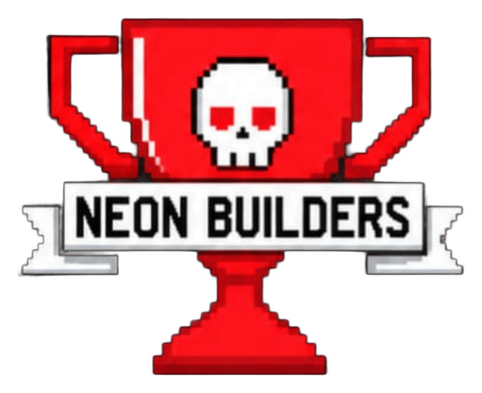

# Neon OS ⚡

### *Con luz y saber, jugamos para crecer*

Plataforma educativa gamificada para estudiantes de grado 11, creada por el equipo **Neon Builders** con la metodología **Design Thinking**
en la Especialización de Tecnología del **Colegio Bilingüe Nuestra Señora del Rosario** (Bogotá, Colombia).


</div>

---

## Índice

1. [¿Qué es Neon OS?](#qué-es-neon-os)
2. [El problema](#el-problema)
3. [Línea de tiempo del proyecto](#línea-de-tiempo-del-proyecto)
4. [El proceso de Design Thinking](#el-proceso-de-design-thinking)
5. [Funcionalidades](#funcionalidades)
6. [Capturas](#capturas)
7. [Arquitectura](#arquitectura)
8. [Cómo ejecutarlo](#cómo-ejecutarlo)
9. [Pruebas](#pruebas)
10. [Estructura del repositorio](#estructura-del-repositorio)
11. [Lo que sigue](#lo-que-sigue)
12. [Equipo](#equipo)

---

## ¿Qué es Neon OS?

Neon OS convierte el estudio en un videojuego. El estudiante entra con su cuenta y ve sus seis materias: Matemáticas, Física, Química,
Ciencias, Sociales e Inglés. Ahí cumple las misiones que publican sus profesores y juega ocho tipos de minijuegos con **721 actividades**
del currículo de grado 11. Cuando falla, la app le explica por qué. Lo que gana en monedas y diamantes lo puede cambiar por beneficios
reales, y si queda entre los diez mejores aparece en el ranking.

Funciona en los computadores del colegio, **sin internet y sin costo**.

| | |
|---|---|
| **Institución** | Colegio Bilingüe Nuestra Señora del Rosario, Bogotá |
| **Cursos** | 1005 – 1002 |
| **Docente** | Juan Camilo Rodríguez Montes |
| **Equipo** | Daniel Santiago Sandoval Torres · Luis Enrique Barreto Duarte |
| **Proyecto** | Del 15 de julio de 2025 al 29 de septiembre de 2026 (las mejoras de la versión 2.0 llegaron en octubre de 2026) |
| **Formato oficial lleno** | [`docs/Formato_Proyecto_Design_Thinking_Neon_Builders.docx`](docs/Formato_Proyecto_Design_Thinking_Neon_Builders.docx) · [PDF](docs/Formato_Proyecto_Design_Thinking_Neon_Builders.pdf) |

---

## El problema

Empezamos mirando qué pasaba en los salones de nuestro colegio y registramos diez situaciones. En siete de ellas el estudiante cambiaba
la clase por una pantalla: videos, redes, Brawl Stars o el celular. Después, entre el 2 y el 22 de octubre de 2025, hicimos una
encuesta que respondieron **75 estudiantes**:

| Lo que encontramos | Dato |
|---|---|
| Lo peor de estudiar es tener «demasiadas tareas» | **35 %** |
| Lo peor de estudiar es «no entiendo bien los temas» | **24 %** |
| Lo peor de estudiar son las «clases largas o aburridas» | **21 %** |
| Aprender en el colegio es «nada» o «casi nada» divertido | **25 %** |
| Lo que más los motiva es «competir y ganar recompensas» | **39 %** |
| Les gustaría aprender con apps o juegos («sí, obvio» o «a veces») | **69 %** |

<p align="center">
  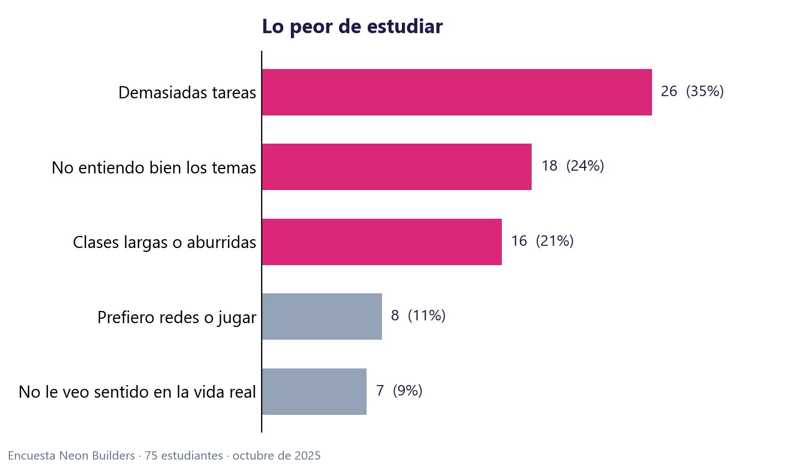
  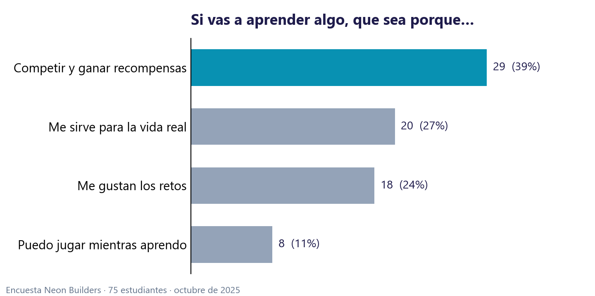
</p>

> **Pregunta de diseño:** ¿Cómo podríamos cambiar el método de aprendizaje de los estudiantes, convirtiendo el repaso de las materias en
> un juego con retos, recompensas y retroalimentación, para generar motivación en el ambiente educativo?

Más detalle en [`docs/ENCUESTA.md`](docs/ENCUESTA.md).

---

## Línea de tiempo del proyecto

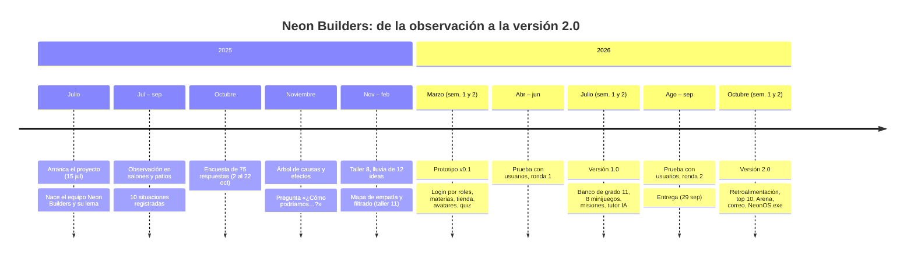

### Julio – noviembre de 2025 · Entender antes de programar

El proyecto arrancó el **15 de julio de 2025**. Primero armamos el equipo y escogimos el nombre, **Neon Builders**, y el lema, *«Con luz y
saber, jugamos para crecer»*. De julio a septiembre observamos a estudiantes de quinto a décimo en salones, salas de tecnología y patios, sin
intervenir. Vimos alumnos durmiendo en el espacio de Prueba Saber, pegados al celular en Química y armando partidas de Brawl Stars en plena
clase de Inglés. Del 2 al 22 de octubre pasamos la encuesta *«Aprendizaje y motivación escolar»* (75 respuestas). En noviembre armamos el
mapa de causas y efectos y concluimos que las tres problemáticas tenían la misma raíz: **la forma de enseñar desmotiva**.

### Noviembre de 2025 – febrero de 2026 · Idear

Hicimos el Taller 8 (las cinco preguntas), una lluvia de **12 ideas** y el mapa de empatía (decir, pensar, hacer, sentir). Después agrupamos
y filtramos las ideas con el taller 11. Ganó **Neon OS**, una plataforma que junta lo mejor de las demás: el *Quiz Royale* y el *Duel Mind*
que inventaron los propios encuestados, el tablero de puntos y la racha diaria.

### 1.ª y 2.ª semana de marzo de 2026 · Prototipo v0.1

Fue el primer código. Separamos lo que el usuario ve (la interfaz) de lo que la app sabe (la base de datos), una idea que dejamos escrita
como «la caja transparente» y «la bóveda». El prototipo tenía:

- Inicio de sesión con tres roles: estudiante, profesor y administrador (`base_de_datos_interfaz_de_inicio.py`).
- Las seis materias con sus colores y las primeras vistas de estudiante, profesor y administrador (`Materias.py`, `estudiante.py`,
  `profesor.py`, `administrador.py`).
- Monedas, diamantes, vidas, racha, **Mercado**, **Tienda** y **avatares** 2D.
- La primera «Arena AI» con quizzes.
- `Encuesta.py`: carga el Excel de la encuesta en la base de datos y genera un
  [informe en PDF con gráficas](docs/informe_encuesta_generado_por_la_app.pdf).
- Un prototipo móvil con Flet (`app_movil.py`) para comparar con la versión de escritorio.

Entre abril y junio lo probamos con compañeros de 1002 y 1005 y con docentes. Nos dijeron que se veía increíble pero que tenía
pocas actividades, que el progreso se perdía al cerrar y que los profesores no podían poner sus propios retos.

### 1.ª y 2.ª semana de julio de 2026 · Versión 1.0

Juntamos todo en una sola aplicación (`APP_final.py`) y le dimos contenido de verdad:

- **Banco de grado 11** (`banco_grado11.py`): 6 materias, 30 temas y 721 actividades (240 preguntas, 181 afirmaciones de cierto o falso,
  150 parejas, 90 palabras y 60 secuencias).
- **Ocho minijuegos** (`juegos.py`): Quiz Relámpago, Cierto o Falso, Memoria de Parejas, Ahorcado, Ordena los Pasos, Burbujas, Adivina el
  Término y Cazador de Errores.
- **Misiones del profesor**: el docente publica tareas, preguntas, quizzes o juegos para su materia y su grado.
- **Tutor con IA local** (`ia_local.py`): usa Ollama, que es gratis y funciona sin internet. Si Ollama no está instalado, la app pasa a un
  modo básico que busca en los apuntes. El profesor también puede editar el banco de preguntas pidiéndoselo a la IA.
- **Base de datos SQLite** (`almacen.py`): usuarios con contraseñas cifradas, misiones y progreso que ya no se pierden al cerrar.
- Primer ranking de estudiantes.

En agosto y septiembre hicimos la segunda ronda de pruebas y el **29 de septiembre** entregamos el proyecto.

### 1.ª y 2.ª semana de octubre de 2026 · Versión 2.0, lo que nos pidieron los usuarios

| Lo que nos dijeron | Lo que hicimos |
|---|---|
| «Cuando me equivoco no sé por qué» | **421 explicaciones**: al fallar la app explica la respuesta y al acertar felicita. |
| «No quiero que vean que quedé de último» | **Ranking top 10**. Quien no está en el top solo ve cuántos puntos le faltan para entrar. |
| «Algo rápido, como una partida de Clash Royale» | **Arena ⚔️**: duelo de 2 minutos contra un robot. |
| «Pongan la serpiente o el Tetris» | **Serpiente** y **Tetris**, con récord personal. |
| «Si juego mucho, me aburro» | **Corazones de Arena**: 5 partidas por día. |
| «¿Y si alguien se registra como profesor sin serlo?» | **Verificación de correo** con un código de 6 dígitos, código de profesor único y administradores predefinidos. |
| «Que no haya que instalar Python» | **`NeonOS.exe`** con logo propio y configuración en `.env`. |
| «Que funcione en el celular» | **Diseño de la nube** en Supabase para compartir cuentas y ranking entre PC y Android. |

Además montamos **470 pruebas automáticas** que revisan registro, juegos, ranking, Arena y correo cada vez que cambiamos el código.

Versión detallada, con los archivos de cada etapa: [`docs/LINEA_DE_TIEMPO.md`](docs/LINEA_DE_TIEMPO.md).

---

## El proceso de Design Thinking

| Etapa | Qué hicimos | Resultado |
|---|---|---|
| **1. Empatizar** | 10 observaciones, conversaciones y encuesta de 75 respuestas | Tres problemáticas: el colegio no divierte, no entienden los temas y se refugian en el celular |
| **1.1 Definir** | Árbol de causas y efectos y fórmula persona + necesidad + razón | *Los estudiantes de 10.° y 11.° necesitan una forma de estudiar con retos, recompensas y explicaciones inmediatas, porque perdieron la motivación con los métodos tradicionales.* |
| **2. Idear** | Taller 8, 12 ideas, mapa de empatía, agrupación y filtrado | Neon OS, una plataforma que reúne las mejores ideas |
| **3. Prototipar** | v0.1 en marzo y v1.0 en julio de 2026 | Aplicación de escritorio funcional |
| **3.1 Evaluar y mejorar** | Dos rondas de prueba y guion de prueba de concepto | 11 mejoras; la v2.0 sale en octubre de 2026 |
| **4. Emprender** | Modelo Canvas, costos e ingresos y plan por fases | Piloto de ≈ $190.000 COP por periodo, financiable con la cooperativa escolar |

El formato completo del colegio, con todas las preguntas respondidas, está en
[`docs/Formato_Proyecto_Design_Thinking_Neon_Builders.docx`](docs/Formato_Proyecto_Design_Thinking_Neon_Builders.docx).

---

## Funcionalidades

**Para el estudiante**
- 🎓 **Mis Materias**: una tarjeta de color por materia, que se pone roja cuando hay una misión pendiente.
- 🧠 **8 minijuegos** con retroalimentación inmediata.
- 🤖 **Tutor IA** por materia, que funciona sin internet.
- ⚔️ **Arena**: duelo contra un robot (100 PV, 2 minutos, 10 s por pregunta), Serpiente y Tetris. Cada partida cuesta 1 corazón y hay 5 por día.
- 🪙 **Economía**: con monedas se compran cosas en el **Mercado** (10 min de música, inmunidad a un quiz, elegir equipo, entrega tarde) y con
  diamantes en la **Tienda** (stickers, snack, entrada de cine, tarjeta de regalo).
- 👤 **Avatares**: unos gratis y otros que se desbloquean con monedas.
- 🔥 **Racha** diaria y ❤️ vidas.
- 🏆 **Muro de los Inmortales**: el top 10 del grado. Comprar cosas no baja el puntaje.

**Para el profesor**
- 🧙 Publicar misiones de tarea, pregunta, quiz o juego, por tema y por grado.
- ✏️ Editar el banco de preguntas con ayuda de la IA local.
- 🏆 Ver el ranking de todos los grados.

**Para el administrador**
- 👁️ Ver el monitoreo, la Arena AI y el ranking, y ocultar o restaurar estudiantes del ranking.
- 🔐 Dos cuentas predefinidas que crean su contraseña en el primer acceso, con un código que llega al correo.

---

## Capturas

> Son capturas reales de la aplicación con datos de demostración.

| Acceso por rol | Mis Materias |
|---|---|
| 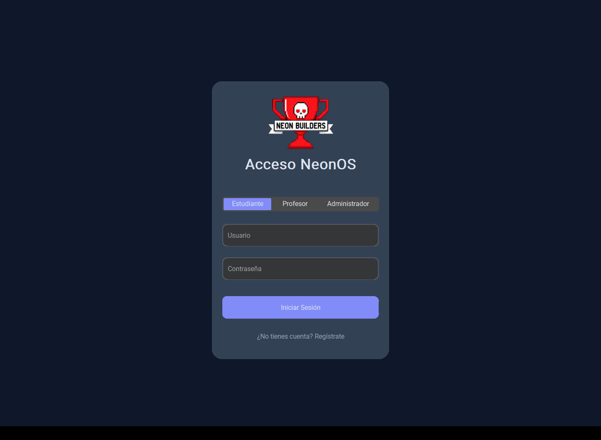 | 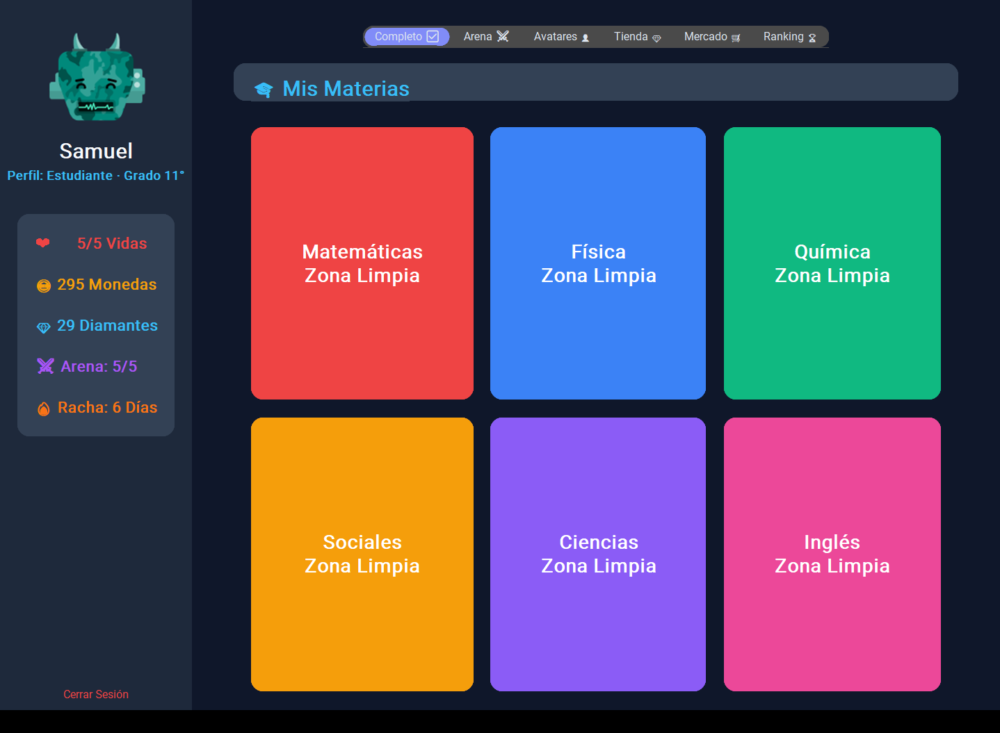 |
| **Dentro de una materia** | **Quiz Relámpago** |
| 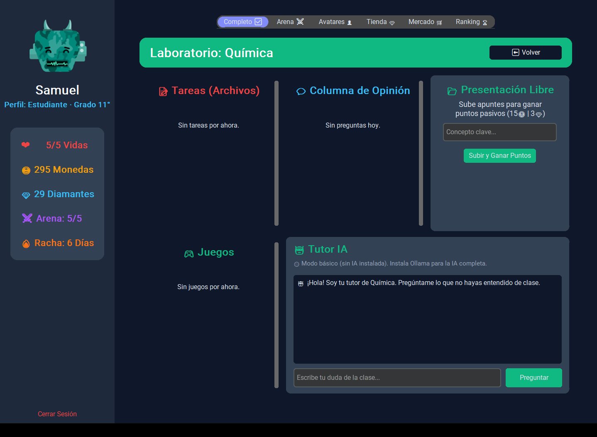 | 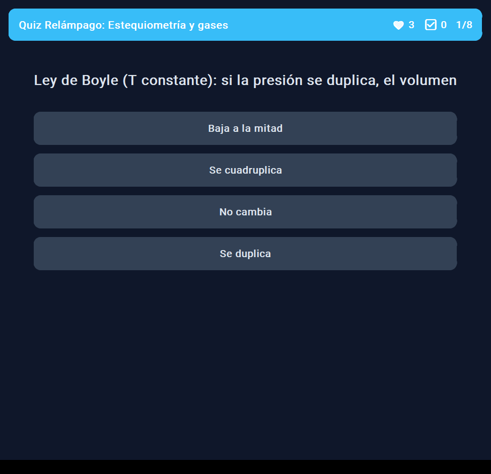 |
| **Arena ⚔️** | **Ranking top 10** |
| 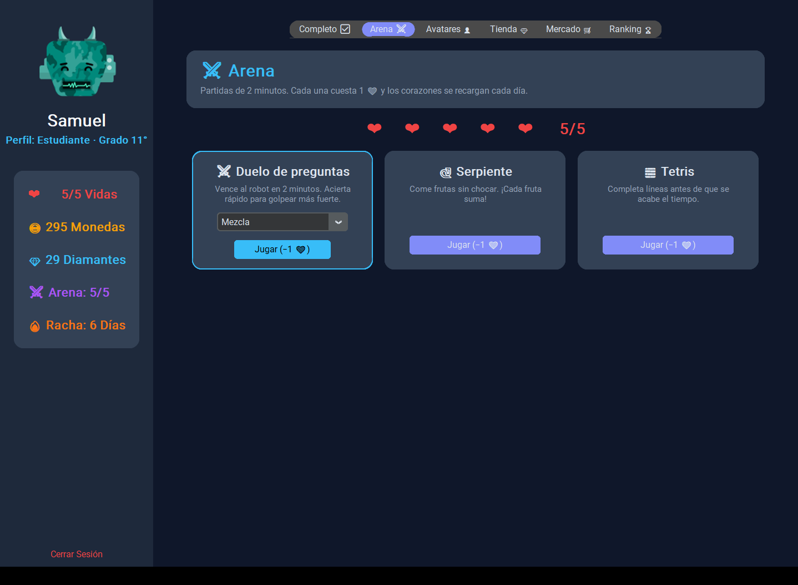 | 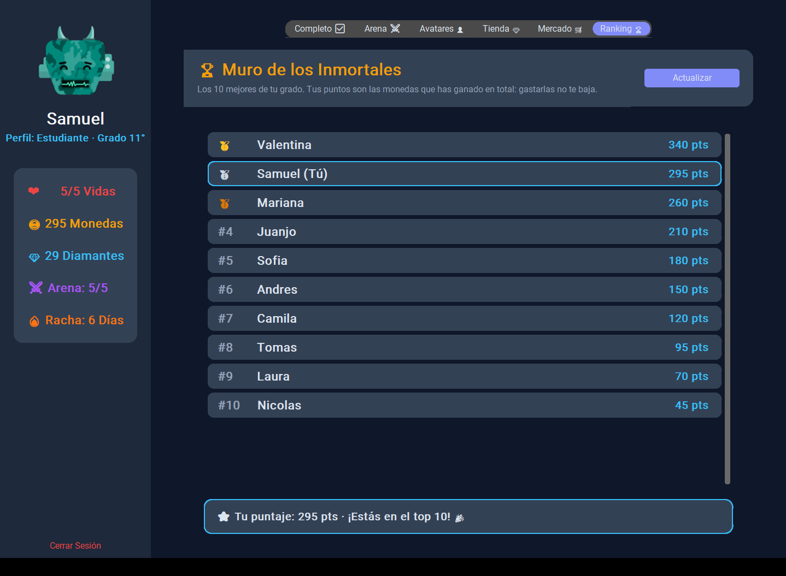 |
| **Mercado escolar** | **Avatares** |
| 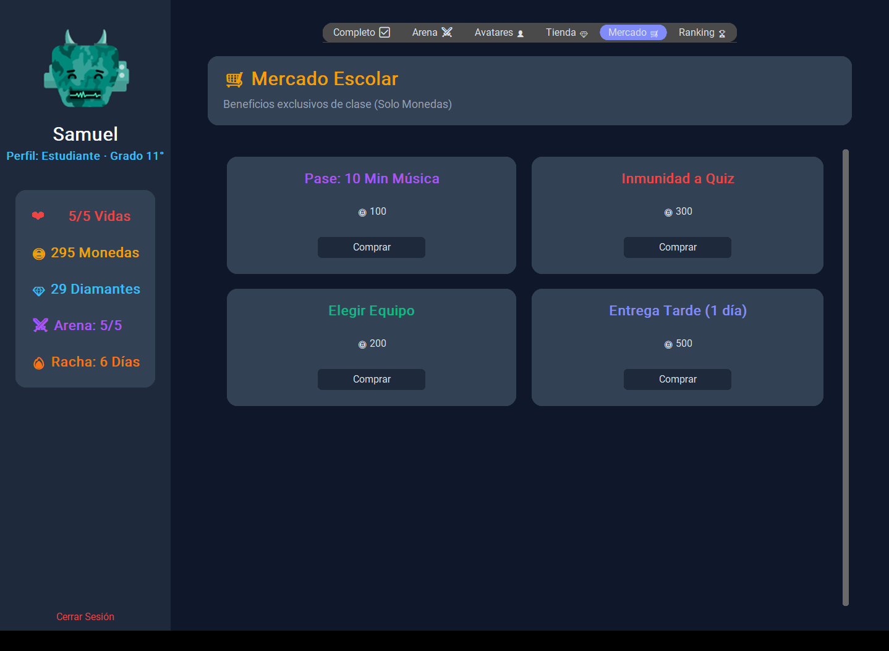 | 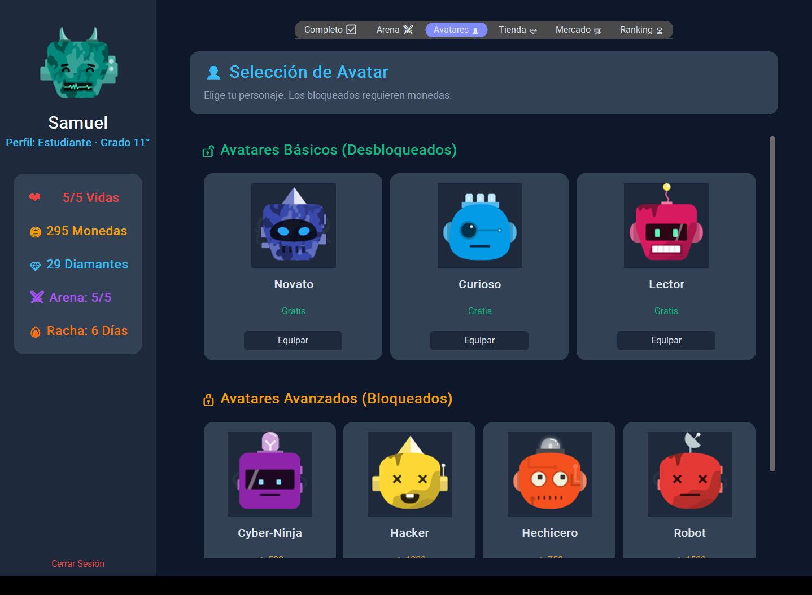 |
| **Panel del profesor** | |
| 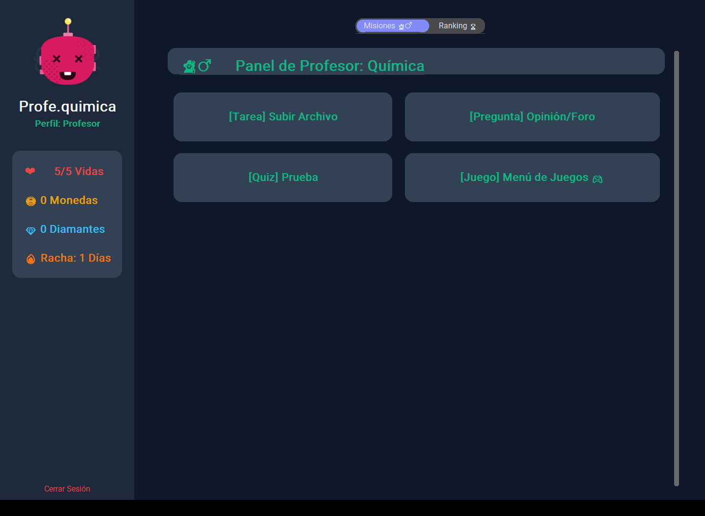 | |

---

## Arquitectura

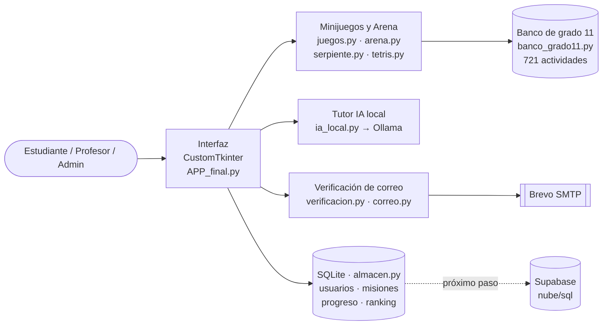

La interfaz solo muestra cosas y no sabe contraseñas ni contenidos. La base de datos guarda la información y la app la consulta cuando la
necesita.

---

## Cómo ejecutarlo

Necesitas Windows y Python 3.10.

```bash
cd neon-os
python -m venv .venv
.venv\Scripts\python -m pip install -r requirements.txt
.venv\Scripts\python APP_final.py
```

- **Correo:** copia `.env.example` como `.env` y llena los datos SMTP; la guía está en [`neon-os/docs/CORREO.md`](neon-os/docs/CORREO.md).
  Para probar sin enviar correos, usa `NEON_CORREO_MODO=consola`.
- **IA completa (opcional):** instala [Ollama](https://ollama.com) y ejecuta `ollama pull qwen2.5:3b`.
- **Ejecutable:** `construir_exe.ps1` genera `NeonOS.exe` con PyInstaller.

> Este repositorio no incluye el archivo `.env`, las bases de datos (`*.db`) ni las respuestas individuales de la encuesta: tienen claves y
> datos personales.

---

## Pruebas

```bash
cd neon-os
.venv\Scripts\python pruebas_verificacion.py
```

| Archivo | Qué revisa | Pruebas |
|---|---|---:|
| `pruebas_verificacion.py` | Códigos de correo, intentos y reenvíos | 114 |
| `pruebas_arena_ui.py` | Pantalla de la Arena y corazones | 69 |
| `pruebas_auth_ui.py` | Registro e inicio de sesión en pantalla | 48 |
| `pruebas_correo.py` | Envío SMTP y mensajes | 48 (1 omitida) |
| `pruebas_feedback.py` | Explicaciones y felicitaciones | 43 |
| `pruebas_entorno.py` | Lectura del `.env` | 37 |
| `pruebas_ranking.py` | Top 10 y puntajes | 33 |
| `pruebas_auth.py` | Cuentas, roles y administradores | 30 |
| `pruebas_arcade.py` | Serpiente y Tetris | 20 |
| `pruebas_logo.py` | Logo e íconos | 17 |
| `pruebas_arena.py` | Reglas del duelo | 11 |
| **Total** | | **470** ✅ |

---

## Estructura del repositorio

```
neon-builders/
├── README.md                     ← este documento
├── docs/
│   ├── Formato_Proyecto_Design_Thinking_Neon_Builders.docx / .pdf
│   ├── LINEA_DE_TIEMPO.md        ← cronología detallada
│   ├── ENCUESTA.md               ← resultados de la encuesta
│   ├── informe_encuesta_generado_por_la_app.pdf
│   ├── capturas/                 ← pantallas reales
│   └── graficas/                 ← gráficas de la encuesta
└── neon-os/                      ← código de la aplicación
    ├── APP_final.py              ← aplicación principal
    ├── juegos.py · arena.py · serpiente.py · tetris.py
    ├── banco_grado11.py          ← contenido de grado 11
    ├── ia_local.py               ← tutor con Ollama
    ├── almacen.py                ← base de datos SQLite
    ├── correo.py · verificacion.py · entorno.py
    ├── Materias.py · estudiante.py · profesor.py · administrador.py   ← módulos del prototipo de marzo
    ├── Encuesta.py               ← análisis de la encuesta
    ├── app_movil.py              ← prototipo móvil (Flet)
    ├── nube/sql/001_esquema.sql  ← diseño de la nube
    └── pruebas_*.py              ← 470 pruebas automáticas
```

---

## Lo que sigue

- [ ] Conectar la app a Supabase y lanzar la versión **Android** con las mismas cuentas y el mismo ranking.
- [ ] Probar el envío de correos con el proveedor real en la red del colegio.
- [ ] Agregar bancos de **grados 6.° a 10.°** y más materias.
- [ ] Hacer **reportes para docentes** con los temas que más falla cada curso.
- [ ] Organizar duelos entre estudiantes y torneos por curso.
- [ ] Medir el impacto comparando notas y simulacros Saber antes y después de un periodo de uso.

---

## Equipo

<table>
  <tr>
    <td align="center"><b>Daniel Santiago Sandoval Torres</b><br/>Investigación, encuesta, contenido académico y pruebas con usuarios</td>
    <td align="center"><b>Luis Enrique Barreto Duarte</b><br/>Programación, base de datos y publicación</td>
  </tr>
</table>

Docente: **Juan Camilo Rodríguez Montes**, Especialización de Tecnología, Colegio Bilingüe Nuestra Señora del Rosario.

<div align="center">

**Neon Builders ⚡ · Con luz y saber, jugamos para crecer**

</div>
