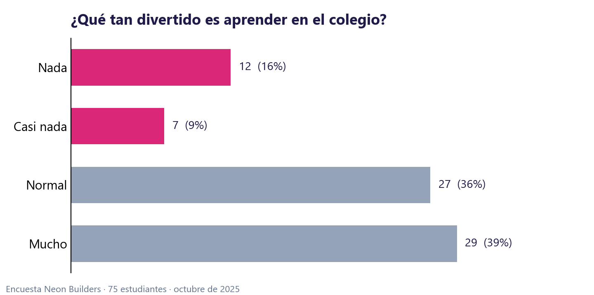
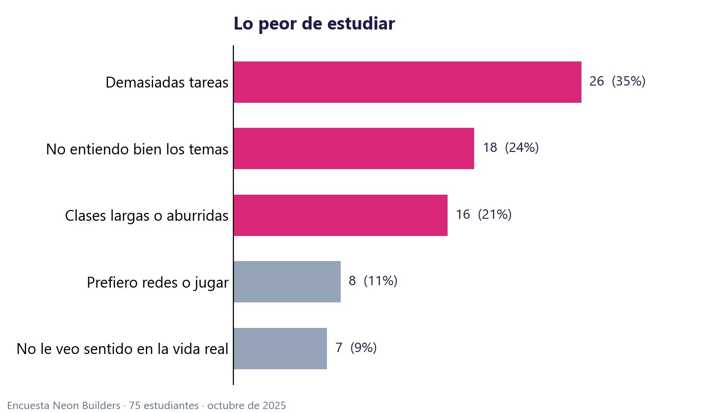
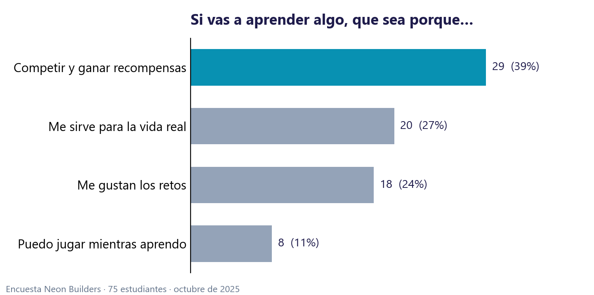
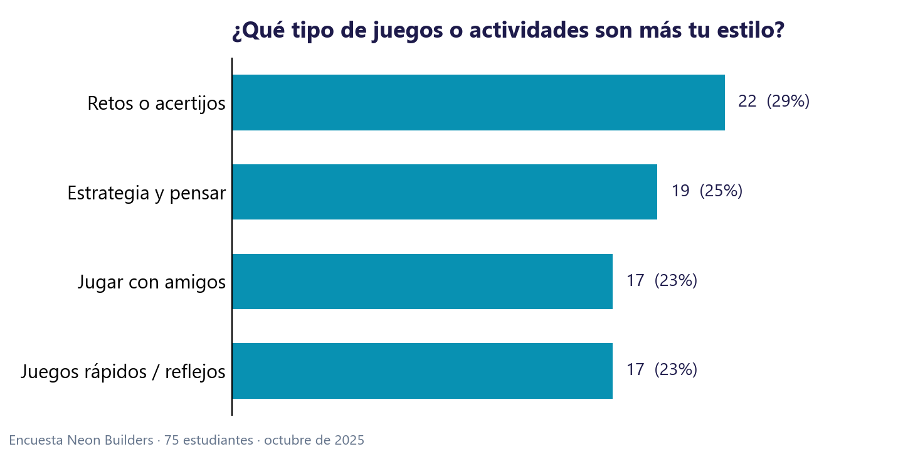
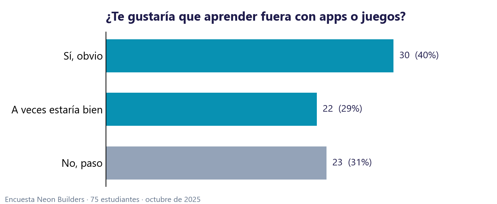
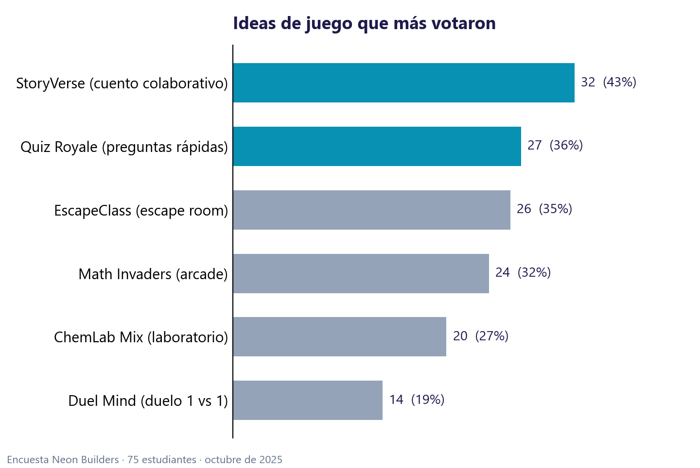

# Encuesta «Aprendizaje y motivación escolar»

- **Herramienta:** Google Forms, exportado a Excel y cargado en la app con `Encuesta.py`.
- **Fechas:** del 2 al 22 de octubre de 2025.
- **Respuestas:** 75 estudiantes del Colegio Bilingüe Nuestra Señora del Rosario.
- **Privacidad:** aquí solo se publican resultados agregados. Las respuestas individuales no se incluyen en el repositorio.

[← Volver al README](../README.md)

---

## 1. ¿Qué tan divertido es aprender en el colegio?

| Respuesta | Estudiantes | % |
|---|---:|---:|
| Mucho | 29 | 39 % |
| Normal | 27 | 36 % |
| Nada | 12 | 16 % |
| Casi nada | 7 | 9 % |

## 2. Lo peor de estudiar

| Respuesta | Estudiantes | % |
|---|---:|---:|
| Demasiadas tareas | 26 | 35 % |
| No entiendo bien los temas | 18 | 24 % |
| Clases largas o aburridas | 16 | 21 % |
| Prefiero estar en redes o jugando | 8 | 11 % |
| No le veo sentido en la vida real | 7 | 9 % |

## 3. Si vas a aprender algo, que sea porque…

| Respuesta | Estudiantes | % |
|---|---:|---:|
| Quiero competir y ganar recompensas | 29 | 39 % |
| Me sirve para la vida real | 20 | 27 % |
| Me gustan los retos | 18 | 24 % |
| Puedo jugar mientras aprendo | 8 | 11 % |

## 4. ¿Qué tipo de juegos o actividades son más tu estilo?

| Respuesta | Estudiantes | % |
|---|---:|---:|
| Retos o acertijos | 22 | 29 % |
| Estrategia y pensar | 19 | 25 % |
| Jugar con amigos | 17 | 23 % |
| Juegos rápidos o de reflejos | 17 | 23 % |

## 5. ¿Te gustaría que aprender fuera con apps o juegos?

| Respuesta | Estudiantes | % |
|---|---:|---:|
| Sí, obvio | 30 | 40 % |
| No, paso | 23 | 31 % |
| A veces estaría bien | 22 | 29 % |

## 6. Ideas de juego (selección múltiple y texto libre)

| Idea | Menciones | % de encuestados |
|---|---:|---:|
| StoryVerse (cuento colaborativo) | 32 | 43 % |
| Quiz Royale (preguntas rápidas) | 27 | 36 % |
| EscapeClass (escape room) | 26 | 35 % |
| Math Invaders (arcade) | 24 | 32 % |
| ChemLab Mix (laboratorio) | 20 | 27 % |
| Duel Mind (duelo 1 vs 1) | 14 | 19 % |

En las respuestas abiertas aparecieron propuestas como un *battle royale* de preguntas rápidas, combates 1 vs 1 con poderes y un juego de
mesa modular. También hubo unas pocas respuestas con mucho desánimo. Por eso decidimos no publicar el texto libre y tratar esos casos
de forma anónima y con cuidado.

## Cómo influyó en el diseño

| Dato | Decisión en Neon OS |
|---|---|
| 39 % se motiva compitiendo y ganando recompensas | Monedas, diamantes, Mercado, Tienda y ranking |
| 24 % no entiende los temas | Explicación en cada error y Tutor IA |
| 35 % tiene demasiadas tareas y 21 % siente las clases largas | Partidas cortas (Arena de 2 minutos) en lugar de talleres largos |
| Quiz Royale y Duel Mind entre las ideas votadas | Duelo de preguntas contra un robot |
| 23 % prefiere juegos rápidos y de reflejos | Burbujas, Serpiente y Tetris |
